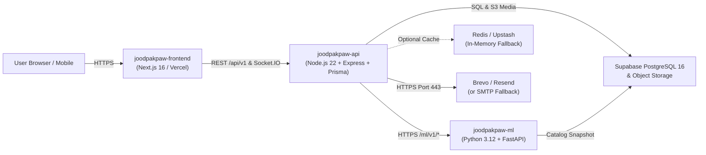

# JoodPakPaw V2 — Pet-Friendly Accommodation & Boarding Marketplace

[](https://github.com/Chocolaz/JOODPAKPAW-V2/actions/workflows/ci.yml)
[](https://github.com/Chocolaz/JOODPAKPAW-V2/actions/workflows/production-smoke.yml)

**JoodPakPaw V2** is a full-stack pet-friendly accommodation and boarding marketplace built for travelers with pets across **all 77 Thai provinces (EN / ไทย)**. It brings together an Airbnb-grade **Next.js 16** discovery frontend, a concurrency-safe **Express + Prisma + Socket.IO** core backend API backed by **PostgreSQL 16 (42 tables)**, and a **Python FastAPI 3-stage hybrid ML recommendation engine** with automatic in-process fallback.

---

## Live Production

| Service | Platform | URL |
| :--- | :--- | :--- |
| **Web Frontend** | Vercel | https://joodpakpaw.vercel.app |
| **Core Backend API** | Render (Singapore) | https://joodpakpaw-api.onrender.com |
| **ML Recommendation Service** | Render (Singapore) | https://joodpakpaw-ml.onrender.com |

---

## System Architecture



---

## Tech Stack Summary

| Layer | Technologies | Notes |
| :--- | :--- | :--- |
| **Frontend (`joodpakpaw-frontend`)** | Next.js 16, React 19, TypeScript, Tailwind CSS v4, `shadcn/ui`, Google Maps JS API, Socket.IO Client | 3D Pastel Clay category rail (`DESIGN.md`), split map view, client-side WebP compression |
| **Backend (`joodpakpaw-api`)** | Node.js 22, Express, TypeScript, Prisma ORM, Socket.IO v4 (`/api/socket.io`), `sharp`, `@aws-sdk/client-s3`, `nodemailer` | Standard `{ code, message, data, pagination? }` envelope, `camelCase` DTOs, row-level booking locks |
| **ML Service (`joodpakpaw-ml`)** | Python 3.12, FastAPI, Uvicorn, Pydantic v2, Scikit-Learn, NumPy, `psycopg` (pool), Pytest, HTTPX | 3-stage pet-aware hybrid filtering, context-aware search re-ranking, TTL snapshot cache |
| **Database & Infra** | PostgreSQL 16 (42 tables / 9 domains), Redis (optional), MinIO / Supabase Storage / Cloudflare R2, Docker Compose, Render, GitHub Actions | Free-tier cloud compatible via `.env` switches + automatic in-process API fallbacks |

---

## Core System Modules & Features

### 1. Discovery & Search (Airbnb-Grade)
- **Bilingual 77-Province Search:** Search stays across all 77 Thai provinces in both **English and Thai** (`provinces` lookup table).
- **Date-Range Availability & Dynamic Pricing:** Filters against `room_category_calendars` to check real room availability across selected `checkIn`/`checkOut` dates and calculates `stayNights` and `stayTotalPrice`.
- **Pet-Aware Filters:** Filter by pet species (`dog`, `cat`, `exotic`), **up-to-max-size** pet size categories, saved user pet profiles (IDOR-protected), facilities, property types, and price range.
- **Geospatial & Visual Discovery:** Haversine distance calculation (`lat`/`lng` → `distanceKm`), interactive Google Maps split view, multi-photo card carousels, and a 9-category **3D Pastel Clay** icon rail defined in [DESIGN.md](DESIGN.md).

### 2. Booking Engine & Lifecycle
- **Concurrency-Safe Row-Level Locking:** Booking transactions lock target `room_category_calendars` rows in PostgreSQL to eliminate double-bookings under concurrent requests.
- **Full Booking Lifecycle:** Supports pending, confirmed, host rejection/reply (`host_reply`, `host_replied_at`), cancellation tracking (`cancelled_by`, `cancellation_reason`), and verified guest reviews.

### 3. 3-Stage Pet-Aware Hybrid ML (`joodpakpaw-ml`)
- **Personalized & Cold-Start Feeds:** Ranks properties for returning users (`/ml/v1/recommend/user/{user_id}`), new/anonymous visitors (`/ml/v1/recommend/cold-start`), and property detail carousels (`/ml/v1/recommend/similar/{property_id}`).
- **Context-Aware Search Re-Ranking (`POST /ml/v1/rank/candidates`):** Re-ranks filtered search candidates using the traveler's pet profile, budget, distance, and amenities, returning explainable match reasons.
- **Cold-Start Resilience:** When `joodpakpaw-ml` is sleeping on free-tier hosting or unreachable within `ML_TIMEOUT_MS`, `joodpakpaw-api` automatically executes an **in-process hybrid ranking fallback** with a single-flight catalog cache so search never stalls.

### 4. Real-Time Chat & Persistent Notifications
- **Socket.IO v4 (`/api/socket.io`):** Real-time guest-to-host messaging rooms paired with REST history endpoints (`/api/v1/chat-rooms`).
- **Notification Center:** Real-time alerts and persistent notification logs (`/api/v1/notifications`).

### 5. Host Portal
- **Multi-Step Property Onboarding:** Guided listing creation with interactive location picker, room categories, pet policies, and image uploads.
- **Room Calendar & Booking Management:** Manage daily room availability/pricing calendars and approve, decline, or reply to bookings.
- **Host KYC Verification:** Identity and property verification submission with optional Gemini Vision pre-screening.

### 6. Admin Portal
- **Moderation & Governance:** Overview dashboard, host KYC verification review, user/property report handling, user ban/appeal state machine with cascade actions, ML recommendation inspector, and immutable admin action logs.

### 7. Security, Media & Transactional Email
- **Authentication & Protection:** JWT access/refresh tokens, OTP email verification, password reset flow, RBAC guards, IDOR ownership checks, and route rate limiting.
- **Image Pipeline & S3 Garbage Collection:** Client-side and server-side (`sharp`) `.webp` optimization with automatic deletion of replaced/orphaned S3 objects.
- **Free-Tier Email Reliability:** Priority dispatch via **Brevo HTTP REST API** (`BREVO_API_KEY` over HTTPS port `443`, bypassing Render Free Tier outbound SMTP port blocks), **SMTP** (`nodemailer`), and **Resend** (`RESEND_API_KEY`), with a safe non-crashing local fallback.

---

## Database Overview (42 Tables / 9 Domains)

Managed with **PostgreSQL 16** and **Prisma ORM** in [`joodpakpaw-api/prisma/schema.prisma`](joodpakpaw-api/prisma/schema.prisma):

```mermaid
erDiagram
    users ||--o{ user_roles : has
    roles ||--o{ user_roles : assigned
    roles ||--o{ roles_permissions : grants
    permissions ||--o{ roles_permissions : mapped
    group_permissions ||--o{ permissions : groups
    users ||--o{ user_verifications : submits

    users ||--o{ properties : hosts
    property_types ||--o{ properties : categorizes
    properties ||--o{ property_images : has
    properties ||--o{ properties_has_facilities : offers
    facilities ||--o{ properties_has_facilities : linked
    facility_categories ||--o{ facilities : groups

    properties ||--o{ room_categories : contains
    pet_size_categories ||--o{ room_categories : max_size
    room_categories ||--o{ room_category_images : has
    room_categories ||--o{ room_category_calendars : availability
    room_categories ||--o{ room_category_has_facilities : offers
    facilities ||--o{ room_category_has_facilities : linked
    room_categories ||--o{ room_has_pets : accepts
    pets ||--o{ room_has_pets : allowed

    users ||--o{ pet_profiles : owns
    pets ||--o{ pet_profiles : species
    pet_breeds ||--o{ pet_profiles : breed
    pets ||--o{ pet_breeds : has
    pet_size_categories ||--o{ pet_profiles : size
    pet_profile_energies ||--o{ pet_profiles : energy

    users ||--o{ bookings : books
    properties ||--o{ bookings : receives
    bookings ||--o{ booking_orders : reserves
    room_categories ||--o{ booking_orders : room
    room_category_calendars ||--o{ booking_orders : date_slot
    bookings ||--o{ booking_pet_profiles : includes
    pet_profiles ||--o{ booking_pet_profiles : staying
    bookings ||--o{ booking_review_images : review_media

    users ||--o{ favorite_folders : creates
    favorite_folders ||--o{ favorite_properties : saves
    properties ||--o{ favorite_properties : bookmarked

    users ||--o{ chat_rooms : participates
    chat_rooms ||--o{ chat_messages : contains
    users ||--o{ chat_messages : sends
    chat_messages ||--o{ chat_message_attachments : attaches

    users ||--o{ notifications : receives
    notification_actions ||--o{ notifications : triggers
    users ||--o{ user_behaviors : logs
    user_behavior_categories ||--o{ user_behaviors : classifies

    users ||--o{ reports : files
    report_categories ||--o{ reports : categorizes
    properties ||--o{ reports : target_property
    bookings ||--o{ reports : target_booking
    reports ||--o{ report_images : evidence
    users ||--o{ audit_logs : audited
    users ||--o{ action_logs : moderated
```



1. **Users & Auth:** `users`, `roles`, `user_roles`, `permissions`, `group_permissions`, `roles_permissions`, `user_verifications`
2. **Pet Profiles & Lookups:** `pet_profiles`, `pets`, `pet_breeds`, `pet_size_categories`, `pet_profile_energies`
3. **Properties & Rooms:** `properties`, `property_types`, `property_images`, `facilities`, `facility_categories`, `properties_has_facilities`, `room_categories`, `room_category_images`, `room_category_has_facilities`, `room_has_pets`
4. **Calendars & Bookings:** `room_category_calendars`, `bookings`, `booking_orders`, `booking_pet_profiles`
5. **Reviews:** `booking_review_images` (plus rating/review fields on `bookings`)
6. **Favorites:** `favorite_folders`, `favorite_properties`
7. **Chat & Notifications:** `chat_rooms`, `chat_messages`, `chat_message_attachments`, `notifications`, `notification_actions`
8. **Moderation, Reports & Analytics:** `reports`, `report_categories`, `report_images`, `audit_logs`, `action_logs`, `user_behaviors`, `user_behavior_categories`
9. **Master Locations:** `provinces` (**77 official Thai provinces** with bilingual EN/TH names)

---

## API & ML Endpoints Overview

### Core Backend API (`/api/v1`)
All API responses follow a unified JSON envelope (`{ code, message, data, pagination? }`) using `camelCase` DTOs. Importable Postman collections and environment files are located in [`postman/`](postman/).

| Route Group | Base Path | Purpose |
| :--- | :--- | :--- |
| **Health** | `/health` | Service & dependency health probe |
| **Auth** | `/api/v1/auth` | Register, login, refresh token, OTP verification, forgot/reset password |
| **Users** | `/api/v1/users` | User profile & account settings |
| **Pet Profiles** | `/api/v1/profiles/pet-profiles` | Traveler pet CRUD & attributes |
| **Properties & Discovery** | `/api/v1/properties` | Filtered search, date-range pricing, details, recommendations (`/recommend`) |
| **Master Lookups** | `/api/v1/pets/all`, `/api/v1/pet-size-categories/all`, `/api/v1/hosts/facilities/all`, `/api/v1/report-categories` | Reference data for search & onboarding |
| **Bookings** | `/api/v1/bookings` | Concurrency-locked booking creation, status transitions, cancellation, reviews |
| **Hosts** | `/api/v1/hosts` | Host listings, room categories, availability calendars, booking actions |
| **Favorites** | `/api/v1/favorite-folders`, `/api/v1/favorite-properties` | Saved stay collections |
| **Chat** | `/api/v1/chat-rooms` | Conversation threads & message history |
| **Notifications** | `/api/v1/notifications` | Persistent notifications & read-state updates |
| **Verifications** | `/api/v1/user-verifications` | Host KYC verification submission & status |
| **Reports** | `/api/v1/reports` | User & property reporting |
| **User Behaviors** | `/api/v1/user-behaviors` | Interaction telemetry for ML personalization |
| **Admin** | `/api/v1/admin` | KYC review, report resolution, ban/appeal management, logs |

### ML Recommendation Service (`/ml/v1`)

| Method & Path | Description |
| :--- | :--- |
| `GET /health` | Returns service status, active `catalog_size`, `snapshot_age_seconds`, and `db_connected` |
| `GET /ml/v1/recommend/user/{user_id}` | Personalized 3-stage hybrid recommendations (supports `limit`, `lat`, `lng`, `debug`) |
| `GET /ml/v1/recommend/cold-start` | Popularity + proximity ranking for cold-start or anonymous users |
| `GET /ml/v1/recommend/similar/{property_id}` | Item similarity recommendations for property detail pages |
| `POST /ml/v1/rank/candidates` | Context-aware re-ranking of filtered search candidate IDs |
| `POST /ml/v1/refresh` | Manually refreshes the in-memory catalog snapshot (protected by `X-ML-Secret`) |

---

## Monorepo Structure

```text
joodpakpaw/
├── joodpakpaw-frontend/   # Next.js 16 (React 19, Tailwind CSS v4, shadcn/ui)
├── joodpakpaw-api/        # Express + TypeScript + Prisma + Socket.IO v4
├── joodpakpaw-ml/         # FastAPI + Scikit-Learn + NumPy recommendation engine
├── postman/               # Postman v2 collection & Local/Production environments
├── docs/                  # Blueprint, backlog, and free-tier cloud deploy guide
├── .github/workflows/     # CI (ci.yml) & 3-hour Production Smoke Check
├── .agents/               # Multi-agent definitions & domain skills
├── docker-compose.yml     # Local orchestration (Postgres, Redis, MinIO, Nginx, API, ML, FE)
├── render.yaml            # Render Blueprint for joodpakpaw-api & joodpakpaw-ml
├── DESIGN.md              # UI/UX & 3D Pastel Clay design system specification
└── AGENTS.md              # Multi-agent governance & Git workflow rules
```

---

## Local Development & Environment Variables

### Option 1: Docker Compose (Recommended)
```bash
docker compose up -d --build
```

### Option 2: Run Services Individually

#### 1. Backend API (`joodpakpaw-api`)
```bash
cd joodpakpaw-api
cp .env.example .env
npm install
npx prisma generate
npm run dev
```

#### 2. ML Service (`joodpakpaw-ml`)
```bash
cd joodpakpaw-ml
cp .env.example .env
python -m venv .venv
pip install -r requirements.txt
uvicorn app.main:app --host 0.0.0.0 --port 5000 --reload
```

#### 3. Frontend (`joodpakpaw-frontend`)
```bash
cd joodpakpaw-frontend
cp .env.example .env.local
npm install --legacy-peer-deps
npm run dev
```

### Key Environment Variables (See `.env.example` in Each Service)

| Service | Variables |
| :--- | :--- |
| **`joodpakpaw-frontend`** | `NEXT_PUBLIC_API_BASE_URL`, `NEXT_PUBLIC_BASE_PATH`, `NEXT_PUBLIC_SOCKET_URL`, `NEXT_PUBLIC_SOCKET_PATH`, `NEXT_PUBLIC_GOOGLE_MAPS_API_KEY` |
| **`joodpakpaw-api`** | `PORT`, `NODE_ENV`, `DATABASE_URL`, `DIRECT_URL`, `REDIS_URL`, `S3_ENDPOINT`, `S3_REGION`, `S3_ACCESS_KEY`, `S3_SECRET_KEY`, `S3_BUCKET`, `S3_PUBLIC_URL`, `S3_FORCE_PATH_STYLE`, `JWT_SECRET`, `JWT_REFRESH_SECRET`, `FRONTEND_URL`, `CORS_ORIGINS`, `BREVO_API_KEY`, `RESEND_API_KEY`, `EMAIL_FROM`, `SMTP_HOST`, `SMTP_PORT`, `SMTP_USER`, `SMTP_PASS`, `ML_SERVICE_URL`, `ML_TIMEOUT_MS`, `ML_INTERNAL_SECRET`, `SUPABASE_URL`, `SUPABASE_ANON_KEY`, `GEMINI_API_KEY` |
| **`joodpakpaw-ml`** | `PORT`, `DATABASE_URL`, `SNAPSHOT_TTL_SECONDS`, `TIME_DECAY_LAMBDA`, `ML_INTERNAL_SECRET` |

---

## Testing, CI/CD & Cloud Deployment

### Local Verification Commands
```bash
# ML Service (pytest)
cd joodpakpaw-ml && pytest -v

# Backend API (Prisma + TypeScript + Build)
cd joodpakpaw-api && npx prisma generate && npm run typecheck && npm run build

# Frontend (Next.js typegen + TypeScript + Production Build)
cd joodpakpaw-frontend && npx next typegen && npm run typecheck && npm run build
```

### GitHub Actions Workflows
- **[`.github/workflows/ci.yml`](.github/workflows/ci.yml):** Runs on pushes and pull requests to `develop` and `main` (`ml-tests`, `api-build`, `frontend-build`).
- **[`.github/workflows/production-smoke.yml`](.github/workflows/production-smoke.yml):** Runs on pushes to `main`, manual workflow dispatch, and every 3 hours (`0 */3 * * *`) to verify live endpoints (`/`, API `/health`, ML `/health`, and `GET /api/v1/properties`).

### Additional Documentation
- **Cloud Deployment Guide:** [`docs/FREE_CLOUD_DEPLOY_GUIDE.md`](docs/FREE_CLOUD_DEPLOY_GUIDE.md)
- **Design System:** [`DESIGN.md`](DESIGN.md)
- **Postman Collection Guide:** [`postman/README.md`](postman/README.md)
