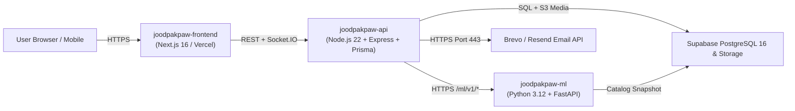

# JoodPakPaw V2 — Pet-Friendly Accommodation & Boarding Marketplace

[](https://github.com/Chocolaz/JOODPAKPAW-V2/actions/workflows/ci.yml)
[](https://github.com/Chocolaz/JOODPAKPAW-V2/actions/workflows/production-smoke.yml)

**JoodPakPaw V2** is a full-stack pet-friendly accommodation and boarding marketplace built for travelers with pets across **all 77 Thai provinces (EN / ไทย)**. It combines a Next.js 16 discovery frontend, an Express + Prisma PostgreSQL 16 core API with Socket.IO real-time messaging, and a Python FastAPI hybrid ML recommendation engine.

---

## Live Production

| Service | Platform | URL |
| :--- | :--- | :--- |
| **Web Frontend** | Vercel | https://joodpakpaw.vercel.app |
| **Core Backend API** | Render (Singapore) | https://joodpakpaw-api.onrender.com |
| **ML Recommendation Service** | Render (Singapore) | https://joodpakpaw-ml.onrender.com |

---

## Architecture



### Key Capabilities
- **Airbnb-Grade Discovery & Pricing:** Filter across 77 Thai provinces (bilingual EN/TH), pet types, pet size categories, check-in/check-out room availability (`room_category_calendars`), price range, facilities, and distance (`lat`/`lng` Haversine) with interactive Google Maps view.
- **3-Stage Pet-Aware Hybrid ML:** Personalized recommendations (`/ml/v1/recommend/user/{user_id}`), cold-start feed (`/ml/v1/recommend/cold-start`), similar stays (`/ml/v1/recommend/similar/{property_id}`), and context-aware search re-ranking (`POST /ml/v1/rank/candidates`) with automatic in-process fallback in `joodpakpaw-api`.
- **Concurrency-Safe Booking Engine:** Row-level locking on room calendars prevents double-booking under concurrent requests.
- **Real-Time Chat & Notifications:** Socket.IO v4 (`/api/socket.io`) paired with persistent in-app notifications.
- **Image Pipeline:** Client/server WebP conversion (`sharp`) and S3-compatible object storage (MinIO locally, Supabase Storage / Cloudflare R2 in production).
- **Transactional Email:** Supports **Brevo HTTP REST API** (`BREVO_API_KEY` over HTTPS 443 for Render Free Tier), **SMTP** (`nodemailer`), and **Resend** (`RESEND_API_KEY`).
- **Host & Admin Portals:** Host room/calendar management, booking lifecycle management, verification review, and admin moderation/ban cascade.

---

## Monorepo Structure

```text
joodpakpaw/
├── joodpakpaw-frontend/   # Next.js 16 (React 19, Tailwind CSS v4, shadcn/ui)
├── joodpakpaw-api/        # Express + TypeScript + Prisma + Socket.IO v4
├── joodpakpaw-ml/         # FastAPI + Scikit-Learn + Pandas recommendation service
├── postman/               # Postman v2 Collection & Local/Production environments
├── .github/workflows/     # CI (ci.yml) & Production Smoke Check (production-smoke.yml)
├── docker-compose.yml     # Local full-stack orchestration (Postgres, Redis, MinIO, Nginx)
├── render.yaml            # Render Blueprint for joodpakpaw-api & joodpakpaw-ml
└── DESIGN.md              # UI/UX & 3D Pastel Clay design system specification
```

---

## Local Development

### Option 1: Docker Compose (Recommended)
```bash
docker compose up -d --build
```

### Option 2: Run Services Individually

#### 1. Backend API (`joodpakpaw-api`)
```bash
cd joodpakpaw-api
npm install
npx prisma generate
npm run dev
```

#### 2. ML Service (`joodpakpaw-ml`)
```bash
cd joodpakpaw-ml
python -m venv .venv
pip install -r requirements.txt
uvicorn app.main:app --host 0.0.0.0 --port 5000 --reload
```

#### 3. Frontend (`joodpakpaw-frontend`)
```bash
cd joodpakpaw-frontend
npm install --legacy-peer-deps
npm run dev
```

---

## Testing & CI/CD

### Local Checks
```bash
# ML Service (pytest)
cd joodpakpaw-ml && pytest -v

# Backend API (TypeScript & Build)
cd joodpakpaw-api && npm run typecheck && npm run build

# Frontend (Next.js typegen, TypeScript, ESLint, Build)
cd joodpakpaw-frontend && npx next typegen && npm run typecheck && npm run build
```

### GitHub Actions Workflows
- **[`.github/workflows/ci.yml`](.github/workflows/ci.yml):** Runs on pushes and pull requests to `develop` and `main` (`ml-tests`, `api-build`, `frontend-build`).
- **[`.github/workflows/production-smoke.yml`](.github/workflows/production-smoke.yml):** Runs on pushes to `main`, manual dispatch, and every 3 hours (`0 */3 * * *`) to verify live endpoints (`/`, `/health` on API & ML, and `GET /api/v1/properties`).
