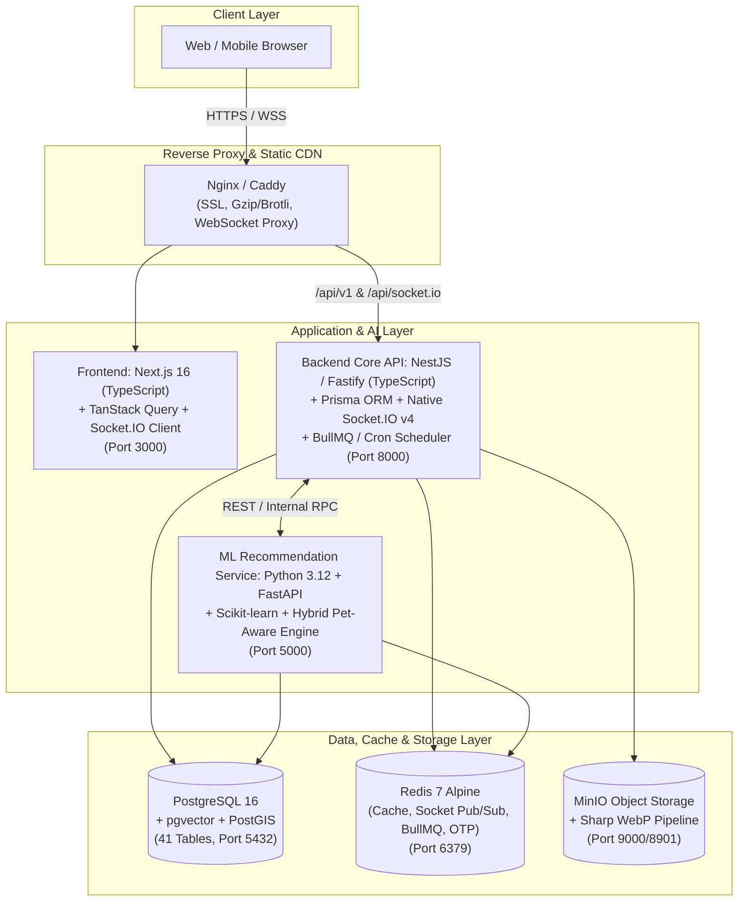

# แผนแม่บทการอัปเกรดสถาปัตยกรรมผลิตภัณฑ์และระบบหลังบ้าน (JoodPakPaw V2.0 Blueprint)
**บทบาท:** Product Manager & Lead System Architect  
**อ้างอิง:** [01_ID65_CapstoneProject_รูปเล่มโครงงานฉบับสมบูรณ์_V1.1.pdf](file:///d:/Project/joodpakpaw/01_ID65_CapstoneProject_%E0%B8%A3%E0%B8%B9%E0%B8%9B%E0%B9%80%E0%B8%A5%E0%B9%88%E0%B8%A1%E0%B9%82%E0%B8%84%E0%B8%A3%E0%B8%87%E0%B8%87%E0%B8%B2%E0%B8%99%E0%B8%89%E0%B8%9A%E0%B8%B1%E0%B8%9A%E0%B8%AA%E0%B8%A1%E0%B8%9A%E0%B8%B9%E0%B8%A3%E0%B8%93%E0%B9%8C_V1.1.pdf) และซอร์สโค้ด [joodpakpaw](file:///d:/Project/joodpakpaw/joodpakpaw)

---

## 1. วิเคราะห์จุดคอขวดเดิม (Pain Points จากรูปเล่ม vs โค้ดจริง)

จากการตรวจทาน **Team Retrospective ทั้ง 3 Releases ในรูปเล่ม (หน้า 47–52)** ประกอบกับไฟล์ [projectchallenge.md](file:///d:/Project/joodpakpaw/joodpakpaw/projectchallenge.md), [explain.md](file:///d:/Project/joodpakpaw/joodpakpaw/explain.md) และซอร์สโค้ดจริง พบจุดที่สามารถ **อัปเกรดให้โปรดักส์สมบูรณ์แบบและมีคุณภาพระดับ Production จริง** ดังนี้:

1. **ความไม่เข้ากันของ Real-time Stack (Go Fiber vs Socket.IO Client):**
   - ในรูปเล่มระบุว่าใช้ SSE แต่โค้ด Frontend จริงใน [lib/socket.ts](file:///d:/Project/joodpakpaw/joodpakpaw/lib/socket.ts) ใช้ `socket.io-client` (`^4.8.3`) แบบบังคับ `transports: ['polling'], upgrade: false` และ Hardcode URL ไว้ เพราะไลบรารี Socket.IO บนภาษา Go ไม่เสถียรกับโปรโตคอล Socket.IO v4 เมื่อทำ WebSocket Upgrade
2. **สิ่งที่เขียนในเอกสารแต่ยังไม่มีในโค้ดจริง (Missing Promises):**
   - **หน้าจัดการปฏิทินห้องพักและปรับราคารายวันของ Host (`room_category_calendars`):** ในบทคัดย่อ, ตารางที่ 1.1 และตารางที่ 19 ระบุว่า Host จัดการวันว่าง–ไม่ว่าง (`unavailable_rooms`) และปรับราคารายวัน (`price_adjustment`) ได้ แต่ในหน้า [HostPropertyDetailPage](file:///d:/Project/joodpakpaw/joodpakpaw/app/profile/host/%5BpropertyId%5D/page.tsx) และ [lib/api.ts](file:///d:/Project/joodpakpaw/joodpakpaw/lib/api.ts) **ยังไม่มี UI และ API สำหรับให้ Host ตั้งค่าปฏิทินรายวันเลย**
   - **Data Fetching & Caching:** ใน [explain.md](file:///d:/Project/joodpakpaw/joodpakpaw/explain.md#L70-L80) ระบุว่าใช้ TanStack React Query แต่ใน [package.json](file:///d:/Project/joodpakpaw/joodpakpaw/package.json) ยังไม่ได้ติดตั้ง ทำให้หน้าแรก [app/(browse)/page.tsx](file:///d:/Project/joodpakpaw/joodpakpaw/app/%28browse%29/page.tsx#L105-L133) ยิง API `getProperties` พร้อมกันถึง **7 Requests** ทุกครั้งที่เข้าหน้าเว็บ และยิง `getPropertyById` แยกทีละตัวสำหรับ Recently Viewed
   - **ระบบบีบอัดและจัดการรูปภาพ (Image Pipeline):** ใน Retrospective รอบที่ 1 (หน้า 47–48) และ [projectchallenge.md](file:///d:/Project/joodpakpaw/joodpakpaw/projectchallenge.md#L17-L19) ระบุปัญหาอัปโหลดไฟล์ใหญ่แล้วพัง/ช้า แต่ยังไม่มีระบบแปลงภาพเป็น **WebP** และย่อขนาดอัตโนมัติ
   - **ระบบแจ้งเตือนล่วงหน้าก่อนวันเช็คอิน (Check-in Reminder):** ใน Backlog `PBI 17.5/17.6` และ `18.5/18.6` มีฟีเจอร์แจ้งเตือนก่อนวัน Check-in แต่ในสถาปัตยกรรมเดิมยังไม่มี **Background Job Scheduler / Queue** ที่ชัดเจน

---

## 2. นำเสนอ Technology Stack ที่เหมาะสมที่สุด (Recommended Modern Stack)

เพื่อเน้นให้ **"ระบบเข้ากันได้ไร้รอยต่อ (Seamless Compatibility) พัฒนาไว ดูแลรักษาง่าย และประสิทธิภาพสูง"** จึงออกแบบ Stack ที่เข้ากับธรรมชาติของ Next.js 16 + TypeScript และงาน AI/ML ดังนี้:

### ทำไมถึงแนะนำการอัปเกรด Stack นี้?

| ส่วนประกอบ (Layer) | ในรูปเล่มเดิม | **Stack ที่อัปเกรด (Optimal & Free-Cloud Ready Stack)** | เหตุผลเชิงวิศวกรรมและโปรดักส์ (Why it's better) |
| :--- | :--- | :--- | :--- |
| **1. Core Backend API (`joodpakpaw-api`)** | Go + Fiber + GORM | **TypeScript + NestJS / Fastify + Prisma ORM + Native Socket.IO v4** | 1. รองรับ **`socket.io` v4 แท้** คู่กับ `socket.io-client` ใน [lib/socket.ts](file:///d:/Project/joodpakpaw/joodpakpaw-frontend/lib/socket.ts) เปิดโหมด **WebSocket แท้** ได้ทันที 2. **แชร์ TypeScript Types** จาก [types/](file:///d:/Project/joodpakpaw/joodpakpaw-frontend/types) ร่วมกับ Frontend ได้ 100% 3. Deploy ฟรีบน **Render / Koyeb** พร้อม In-Process ML Fallback ยาม Cold Start |
| **2. Database (`joodpakpaw-postgres`)** | PostgreSQL 15 Alpine (41 ตาราง) | **PostgreSQL 16 (Local Docker & Supabase / Neon Free Tier)** | คงโครงสร้าง 41 ตารางตามรูปเล่มให้ครบถ้วน เชื่อมต่อผ่าน `DATABASE_URL` รองรับทั้ง Local และ Supabase/Neon ฟรี |
| **3. Cache & Queue (`joodpakpaw-redis`) — *[เพิ่มใหม่]*** | ไม่มี (เก็บ OTP ลงตาราง `users` และคิวรี่สถิติสดทุกครั้ง) | **Redis 7 Alpine / Upstash Free Redis + In-Memory Auto-Fallback** | รองรับ Redis ในเครื่องและ Upstash ฟรี พร้อมโหมด **Auto-Fallback (In-Memory Cache + `node-cron`)** เมื่อไม่ตั้งค่า `REDIS_URL` บนโฮสต์ฟรี |
| **4. Machine Learning (`joodpakpaw-ml`)** | Python + FastAPI + Pandas/NumPy (PoC พื้นฐาน) | **Python 3.12 + FastAPI + Scikit-learn + Hybrid Recommendation Engine** | ยกระดับเป็น **3-Stage Hybrid Recommender** พร้อม Deploy ฟรีบน **Hugging Face Spaces (Docker 16GB RAM)** หรือ Render |
| **5. Object Storage (`joodpakpaw-minio`)** | MinIO เก็บไฟล์ดิบ | **S3-Compatible Storage (`joodpakpaw-minio` / Cloudflare R2 Free 10GB / Supabase S3)** | บีบอัดและแปลงทุกรูปเป็น `.webp` อัตโนมัติ เปลี่ยน `.env` สลับจาก MinIO ในเครื่องไปขึ้น Cloudflare R2 หรือ Supabase Storage ฟรีได้ทันที |

---

## 3. แนวทางการอัปเกรดระบบ Machine Learning (`joodpakpaw-ml`)

ยกระดับเป็น **3-Stage Hybrid Recommendation Pipeline**:

1. **Stage 1: Pet Safety & Hard Filter** — กรองที่พักที่รับประเภทสัตว์ (`pet_types`) และช่วงน้ำหนัก (`pet_size_categories`) ที่ตรงกับสัตว์เลี้ยงของผู้ใช้จริง
2. **Stage 2: Content & Energy Matching** — จับคู่ระดับพลังงานสัตว์เลี้ยง (`pet_energies` 1–5) กับสิ่งอำนวยความสะดวก (`facilities`) และพื้นที่ห้องพัก ร่วมกับ TF-IDF + Cosine Similarity
3. **Stage 3: Behavioral Time-Decay & Bayesian Quality Boost** — ถ่วงน้ำหนักพฤติกรรมการเข้าชม (`user_behaviors`) และรายการโปรด (`favorite_properties`) ด้วย Exponential Time-Decay ร่วมกับ Bayesian Weighted Rating สำหรับ Cold-Start

---

## 4. แนวทางการอัปเกรดโค้ดฝั่ง Frontend ([joodpakpaw](file:///d:/Project/joodpakpaw/joodpakpaw))

1. **เพิ่ม UI จัดการปฏิทินห้องพักและราคารายวันสำหรับ Host (`room_category_calendars`)** ในหน้า [HostPropertyDetailPage](file:///d:/Project/joodpakpaw/joodpakpaw/app/profile/host/%5BpropertyId%5D/page.tsx) และ [ManageRooms.tsx](file:///d:/Project/joodpakpaw/joodpakpaw/app/profile/host/_components/ManageRooms.tsx)
2. **เพิ่มระบบบีบอัดและแปลงรูปภาพเป็น WebP ฝั่ง Client** ก่อนส่ง `FormData`
3. **อัปเกรด Real-time Socket ([lib/socket.ts](file:///d:/Project/joodpakpaw/joodpakpaw/lib/socket.ts))** ให้รองรับ WebSocket Upgrade และอ่านค่า URL จาก Environment Variable
4. **ซิงค์สถานะอ่านแจ้งเตือน (`is_read`) กับฐานข้อมูล** ใน [NotificationContext.tsx](file:///d:/Project/joodpakpaw/joodpakpaw/app/_components/NotificationContext.tsx)
5. **ปรับปรุงประสิทธิภาพการดึงข้อมูลหน้า Home ([app/(browse)/page.tsx](file:///d:/Project/joodpakpaw/joodpakpaw/app/%28browse%29/page.tsx))**

---

## 5. แผนการดำเนินงานและระยะเวลา (Upgraded Roadmap & Timeline)

| เฟส (Phase) | รายละเอียดงาน (Backend + ML + Frontend Upgrade) | ระยะเวลา (ทำร่วมกับ Multi-Agent) | ระยะเวลา (ทีมพัฒนาปกติ) |
| :--- | :--- | :---: | :---: |
| **Phase 0: Modern Infrastructure & Database 41 Tables** | `docker-compose.yml` (`joodpakpaw-postgres`, `joodpakpaw-redis`, `joodpakpaw-minio`, `joodpakpaw-api`, `joodpakpaw-ml`) + 41 Tables Schema + Seed Data | **1 วัน** | **3 – 4 วัน** |
| **Phase 1: Auth, User, Property & Room Categories + Image Pipeline** | Auth API + Error Codes (`T-2007`, `A-3xxx`) + User/Pet/Property/Room CRUD + S3/MinIO WebP Pipeline + FE Image Compression & Root Path `/` | **1 – 2 วัน** | **5 – 6 วัน** |
| **Phase 2: Booking Engine, Room Calendar, Favorites & Reviews** | Row-Locked Booking Engine + Host Room Calendar API & UI + Favorites (`FF-4101`) + Reviews | **2 วัน** | **6 – 7 วัน** |
| **Phase 3: Real-time WebSocket (Chat & Notification), Verification & Admin** | Native Socket.IO v4 Server + Chat & Notifications + KYC Verification + Admin Report/Ban State Machine | **2 วัน** | **6 – 8 วัน** |
| **Phase 4: Hybrid ML Recommendation Service & Frontend Performance** | `joodpakpaw-ml` 3-Stage Hybrid Recommender + Cold-Start Fallback + User Behavior Tracking + Home Feed Optimization | **1 – 2 วัน** | **4 – 5 วัน** |
| **รวมระยะเวลาทั้งหมด** | **ระบบ Full-Stack + Hybrid ML + Upgraded Frontend พร้อมใช้งานจริง** | **7 – 9 วัน** | **24 – 30 วันทำการ** |
